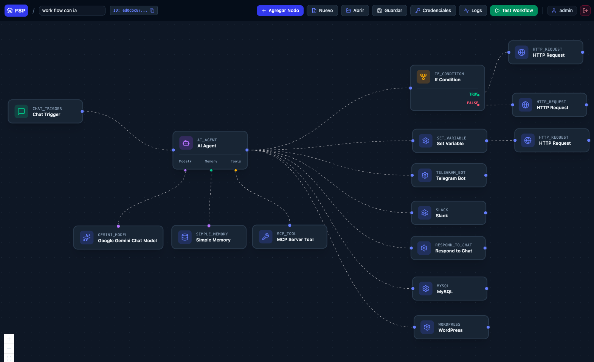
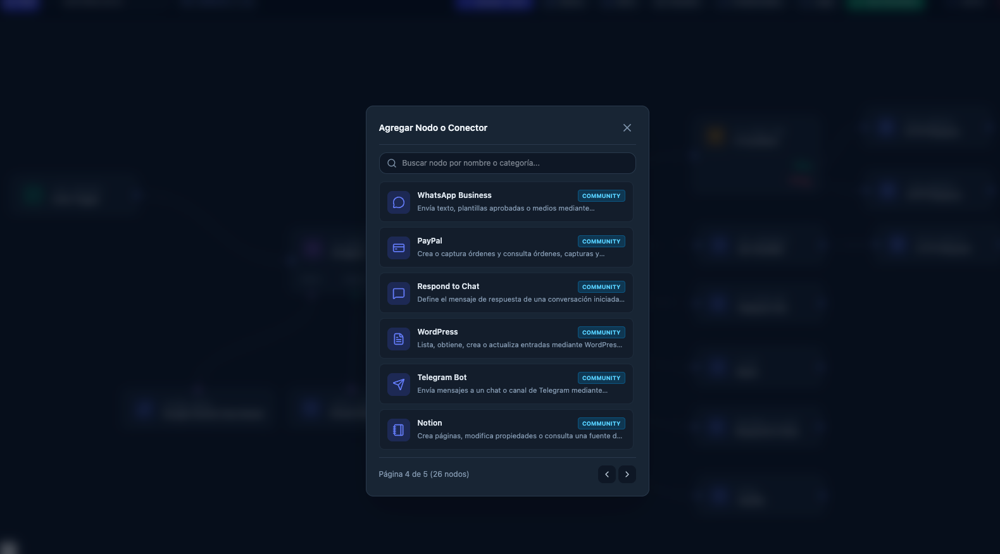
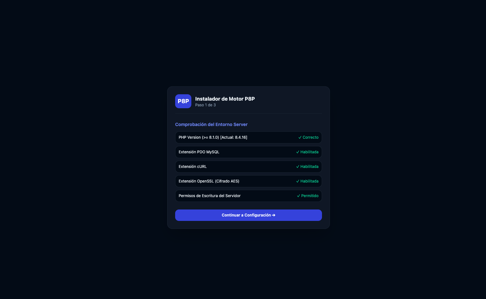

# p8p ⚡

> **p8p** (pronounced *p-eight-p*) is a lightweight, self-hosted visual workflow automation engine built with **PHP** and **React Flow**. Designed to give you the power and flexibility of tools like n8n or Make, but optimized to run seamlessly on standard shared hosting environments (cPanel) without requiring Node.js servers or complex infrastructure.

---

## 🖼️ See p8p in action

### Visual workflow editor

Connect chat triggers, AI agents, conditions, and integrations on a single canvas. Build workflows with Telegram, Slack, MySQL, WordPress, and HTTP requests using configurable nodes.

### Selector de Nodos y Conectores

El modal para agregar nodos cuenta con búsqueda en tiempo real y paginación para explorar fácilmente todo el ecosistema de conectores disponibles (Core, Community y Premium).

### Guided installation

The web installer checks your PHP environment and required extensions before you continue to configuration.

---

## ✨ Features

- 🎨 **Modern Visual Node Canvas:** Fluid drag-and-drop interface powered by React Flow with custom node modals, side panels, and clean connection edges.
- 🚀 **Shared Hosting Ready:** Runs on standard PHP (8.1+) & MySQL/MariaDB/SQLite setups. No long-running Node processes required.
- ⏱️ **Cron-Driven Queue System:** Asynchronous background execution using database queues and standard cron jobs.
- 🔌 **Extensible Plugin/Connector Architecture:** Easily build custom connectors or integrate third-party APIs via Composer packages.
- 🤖 **AI & MCP Compatible:** Native structure ready for Model Context Protocol (MCP) integrations and LLM agents.
- 📊 **Execution History & Debugger:** Step-by-step logs and variable inspection for every workflow run.

---

## 🛠️ Tech Stack

- **Backend:** PHP 8.1+ (PSR-compliant architecture)
- **Frontend:** React + React Flow + TailwindCSS
- **Database:** SQLite / MySQL / MariaDB
- **Queue/Cron:** Database-backed task processing via Scheduled Jobs

---

## 🤝 Contributing & Roadmap

`p8p` is an open-core project. We welcome contributions for core features, frontend enhancements, and new integration connectors!

See our [Roadmap](./ROADMAP.md) for upcoming features.

---

## 📄 License

Distributed under the MIT License. See `LICENSE` for more information.